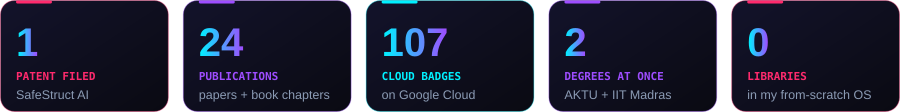
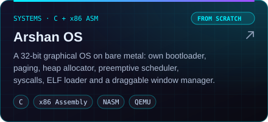
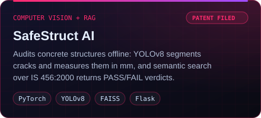
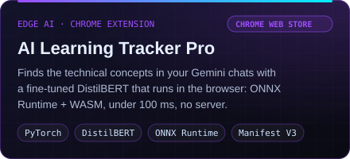
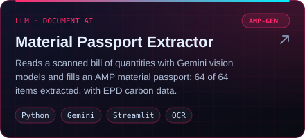
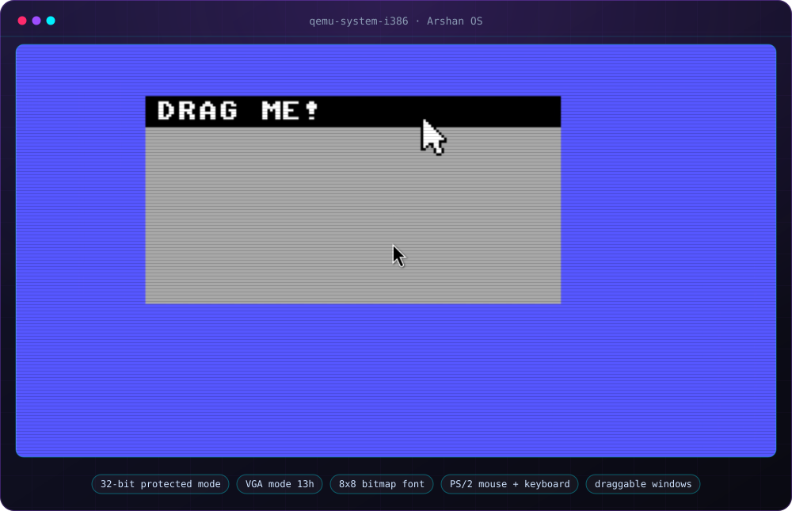

<!-- Visual assets live in /assets. Regenerate them with: python tools/build_assets.py -->

  

  &nbsp;
  &nbsp;
  

  I started in <b>civil engineering</b> (a diploma from AMU), got hooked on code, and now study for two degrees at once:
  a <b>B.Tech in Computer Science</b> at AKTU (final year) and a <b>BS in Data Science</b> at IIT Madras.
  These days I build AI for the built environment, and the occasional operating system.

  

## ⚡ Right now

- 🏛️ **AI/ML Intern, IIT Roorkee** (Dept. of Architecture and Planning). On the AMP-GEN project of the Google Centre for Climate Technology, I build LLM + RAG pipelines that read Environmental Product Declarations and compute a Material Circularity Index for automated material passports. I also built a real-time thermal-imaging pipeline on a Raspberry Pi Zero 2 W for a kinetic facade.
- 🧪 **Founder, Arshan Labs.** Shipping AI Learning Tracker Pro, an on-device NLP extension on the Chrome Web Store.
- 🏠 **Regional Coordinator (Lucknow), Saranda House, IIT Madras.** Meetups for the BS community, plus the house's posters and videos.

## 🛠️ Featured work

  
  

  
  

  
  

  <b>Try them live:</b> <a href="https://collabsphere-one.vercel.app">CollabSphere</a> · <a href="https://sy-professionals.vercel.app">SY Professionals</a> · <a href="https://arshanalikhan.github.io/online-quiz-application/">Online Quiz App</a>

  
   
  <b>Arshan OS, running in QEMU.</b> Every pixel, interrupt and memory allocation in that window comes from my own C and x86 Assembly.

<b>More projects</b>

 

| Project | What it is | Built with |
|---|---|---|
| [The Multiverse](https://github.com/arshanalikhan/ai-cinematic-workflow) | An AI music video: characters kept consistent across shots with master prompts, animated with Veo, graded in DaVinci Resolve | Gemini, Veo, DaVinci Resolve |
| [AI-Driven Educational Framework](https://github.com/arshanalikhan/ai-driven-educational-framework) | Adaptive learning on PISA/TIMSS data, with a multilingual voice interface and bias monitoring | Python, scikit-learn, TensorFlow, Docker |
| [AI for Inclusive Education](https://github.com/arshanalikhan/Engineering-Python-Powered-AI-for-Inclusive-Education-and-Skills-Development) | Code and data for my paper: RL content sequencing, collaborative filtering, dynamic difficulty | Python |
| [Invisible Cloak](https://github.com/arshanalikhan/Invisible-Cloak) | A real-time "invisibility cloak" effect using HSV colour masking | Python, OpenCV |
| [Online Quiz App](https://arshanalikhan.github.io/online-quiz-application/) | Trivia quizzes with timers and instant scoring | HTML, CSS, JavaScript |

## 📚 Free study kits

Exam-prep sites I built while studying for these courses. Free for anyone taking them.

| Course | What's inside |
|---|---|
| [**AKTU BCS701: Artificial Intelligence**](https://arshanalikhan.github.io/aktu-bcs701-ai-prep/) | Unit-wise notes with diagrams, past-paper analysis, a solved 2025-26 paper, mock papers |
| [**AKTU BCS071: Cloud Computing**](https://arshanalikhan.github.io/aktu-bcs071-cloud-prep/) | Unit-wise notes, PYQ analysis, a solved 2025-26 paper, mock papers |
| [**NPTEL: Cloud Computing** (IIT Kharagpur)](https://arshanalikhan.github.io/nptel-cloud-computing-prep/) | Notes, formula sheet, most-repeated questions, practice bank, timed mocks |
| [**NPTEL: Generative AI and LLMs** (IIM Bangalore)](https://arshanalikhan.github.io/nptel-genai-llm-prep/) | Week notes, diagrams, Hinglish videos, numericals, timed mock papers |
| [**IIT Madras BS: Statistics II**](https://arshanalikhan.github.io/iitm-stats2-prep/) | Quiz 1 notes, formula sheet, past quiz patterns, number drills, mock quizzes |
| [**MJPRU: Digital Image Processing**](https://arshanalikhan.github.io/dip-mjpru-prep/) | PYQ analysis, unit notes, mock papers with answers |
| [**DSA in Python**](https://github.com/arshanalikhan/dsa-python-notes) | Video-wise notes (Markdown + PDF) for the Code & Debug playlist |

## 🏆 Highlights

- 🧾 **Patent filed** for SafeStruct AI: application 202611077952, IP India (June 2026)
- 📄 **24 publications**: 4 book chapters, a journal article, 7 IEI seminar abstracts and 12 international conference papers on AI, IoT and infrastructure
- 🎓 **Aspire Leaders Program**, Cohort 5 (Aspire Institute, founded at Harvard): one of 9,988 finalists from 54,337 applicants, later given **HBS Foundry** access
- 🧭 **Stanford Faculty Mentorship Cohort**, 2025/26
- 🥇 **1st place**, AI Exhibition at the Pre-India AI Summit 2026 · **1st place**, Brain Blitz multi-language coding quiz (Aahvan 2025)
- 🥉 **3rd place**, AI Turbo Challenge at the AKTU inter-university fest (zonal) · **3rd place**, Code Quest '24
- ☁️ **107 Google Cloud skill badges**: generative AI, agents with ADK, Kubernetes, Terraform, BigQuery, Cloud Run

<b>Selected publications</b>

 

**Book chapters**
- *AI-Assisted Teaching and Learning of Indian Standard Codes in Civil Engineering Education*, in Pedagogical Advances in Teaching, Learning and Research (2026), ISBN 978-93-6126-708-3
- *Converging AI Frontiers: Edge Generative Models, Scalable Secure Architectures, and Industry 5.0 Applications*, in Intelligent Computing and AI Frontiers, Bhumi Publishing (2026), ISBN 978-93-47587-80-1
- *Autonomous Intelligence as Algorithmic Sapience and Data-Centric Intelligence*, in Future of AI and Data Science, Vol. II, Bhumi Publishing (2026), ISBN 978-81-688266-6-3
- *Convergent Intelligent Innovations Across Science, Humanities, Commerce, Management, AI, Cyber Law and Data Systems*, in Innovations Across Disciplines, Vol. I, Nature Light Publications (2026), ISBN 978-81-69492-00-3

**Journal**
- *Empowering Gen Alpha and Beta: AI-Driven Educational Systems in 2050*, JIIEMS Vol. 4 (2025), ISSN 2347-6184

Plus 7 IEI seminar abstracts and 12 international conference papers, including *Engineering Resilient AI-Driven Learning: A Python-Powered Framework* and *AI-Driven Intelligent Transportation Systems for Sustainable Smart Mobility*.

## 🧰 Tech I work with

  

  
  
  
  
  
  
  
  
  

## 🐍 My contribution graph, eaten

<picture>
  <source media="(prefers-color-scheme: dark)" srcset="https://raw.githubusercontent.com/arshanalikhan/arshanalikhan/output/snake-dark.svg">
  <source media="(prefers-color-scheme: light)" srcset="https://raw.githubusercontent.com/arshanalikhan/arshanalikhan/output/snake-light.svg">
  
</picture>

  

